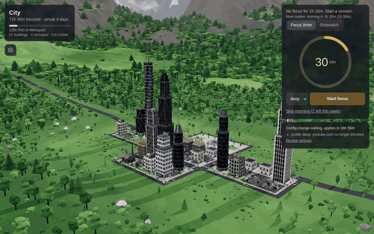
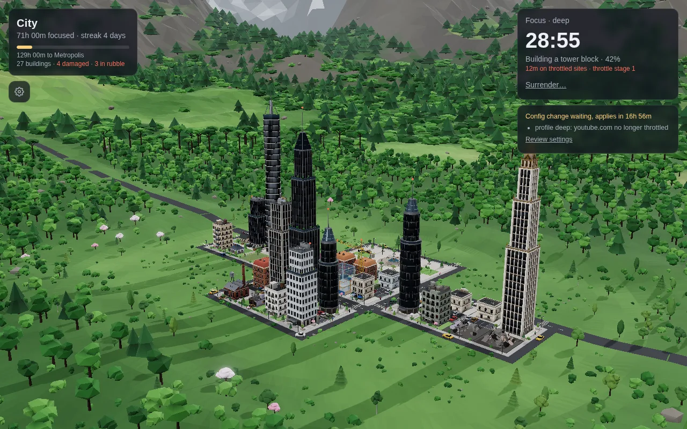
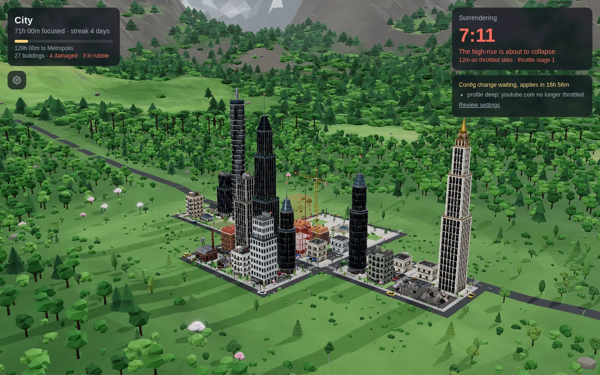
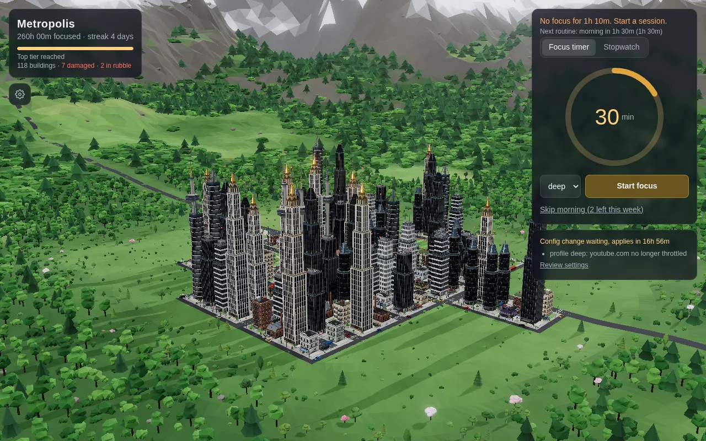
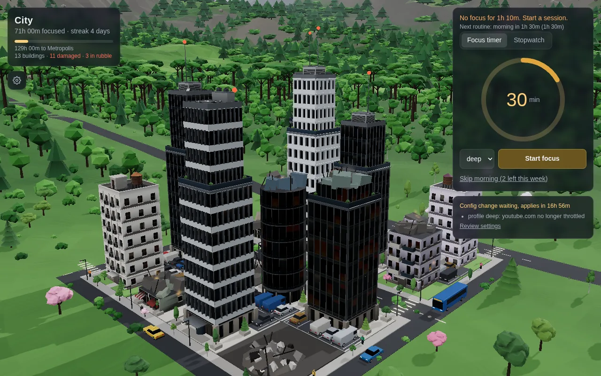
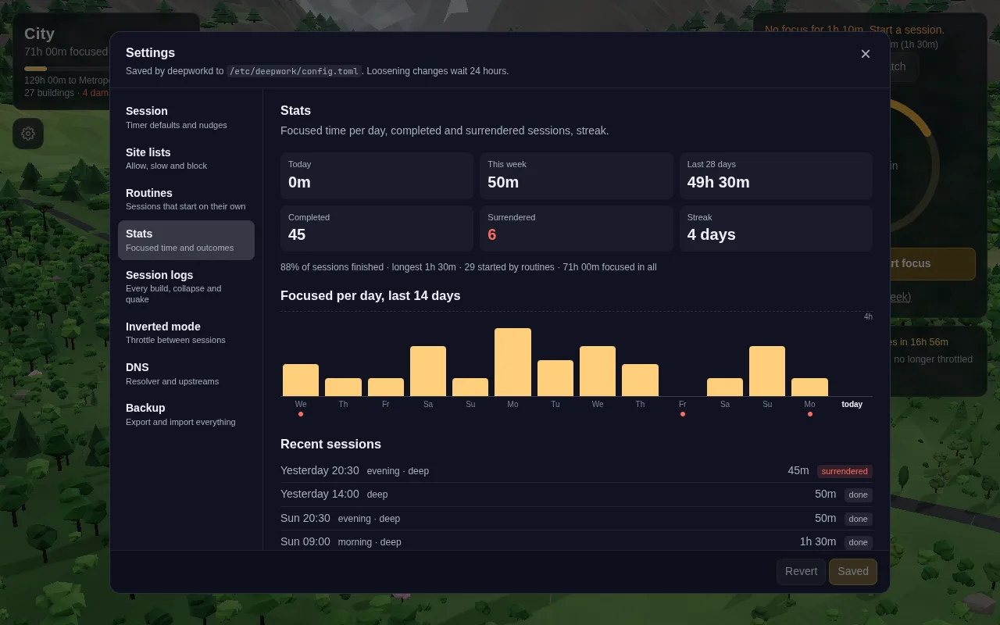
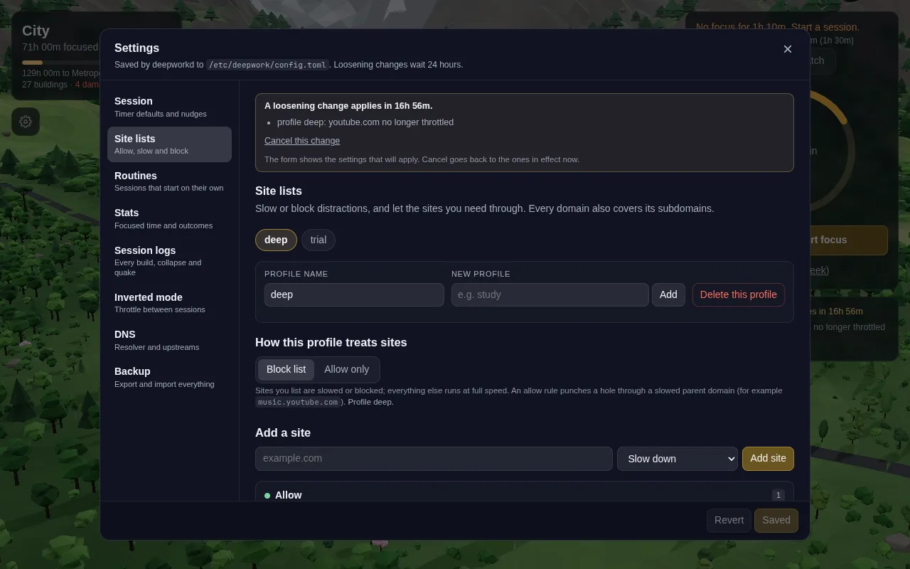

<div align="center">


# DeepWork

### Focus builds a city. Giving in tears it down.

[How it works](#how-it-works) · [Tour](#tour) · [Quick start](#quick-start) · [Docs](docs/PLAN.md)

**A focus app for Linux that is hard to get around.**<br>
Distracting sites slow to a crawl at the network layer, routines start sessions on their own, and every early quit costs you a building.

[](Cargo.toml)
[](ui/src-tauri)
[](ui/src/city)
[](dist/PKGBUILD)
[](https://omarchy.org)
[](LICENSE)

[](https://github.com/Sagyam/DeepWork/actions/workflows/package.yml)




</div>

## How it works

| | |
|---|---|
| 🐢 **Throttle, don't kill** | Distracting sites buffer and load slowly; docs, mail and work sites run at full speed. |
| 🛡️ **Root daemon** | `deepworkd` enforces with nftables, tc/netem, its own DNS and SNI checks. Closing the app changes nothing. |
| ⏰ **Routines** | Focus slots start on their own. A few skips a week, no more. |
| 🏙️ **A city that remembers** | Finished sessions raise buildings. Surrendering, tampering or bypassing cracks or levels them. |
| 🚪 **A way out, never a lockout** | Surrender takes 10 minutes, sessions cap at 6 hours, and TTY root always works. |

<details>
<summary><b>What it holds up against</b></summary>

| You try | DeepWork |
|---|---|
| Close the app or kill the daemon | Rules stay in place; the daemon restarts |
| Reboot or suspend | Session resumes; time only counts while awake |
| `dig @8.8.8.8`, DoH, QUIC | Redirected, dropped, or forced back to TCP |
| `sudo nft flush ruleset` | Repaired within a second, and it costs you |
| `sudo` / `pkexec` mid-session | Denied until the session ends |
| Loosen the config | Waits 24 hours; tightening is instant |

Full threat model: [docs/PLAN.md](docs/PLAN.md#threat-model).
</details>

## Tour

| | |
|:---:|:---:|
|  |  |
| **In session.** Each one raises a building. | **Surrender.** Ten minutes to change your mind. |
|  |  |
| **260 hours in.** A metropolis. | **What giving in costs.** Cracks and rubble. |
|  |  |
| **Stats.** Every session, kept or quit. | **Site lists.** Loosening them waits a day. |

## Quick start

```sh
git clone https://github.com/Sagyam/DeepWork && cd DeepWork/dist
makepkg -si
sudo systemctl enable --now deepworkd.service
systemctl --user enable --now deepwork-agent.service
deepwork start 50m
```

| Requires | |
|---|---|
| OS | Arch Linux (built on Omarchy / Hyprland) |
| Kernel | nftables, tc/netem |
| DNS | systemd-resolved (works with DNS-over-TLS) |

## Docs

- [Development](docs/DEVELOPMENT.md): layout, building without root, CLI
- [Plan](docs/PLAN.md): design, threat model, roadmap

<div align="center"><sub>MIT · Created in <a href="https://t3.codes">T3 Code</a></sub></div>
